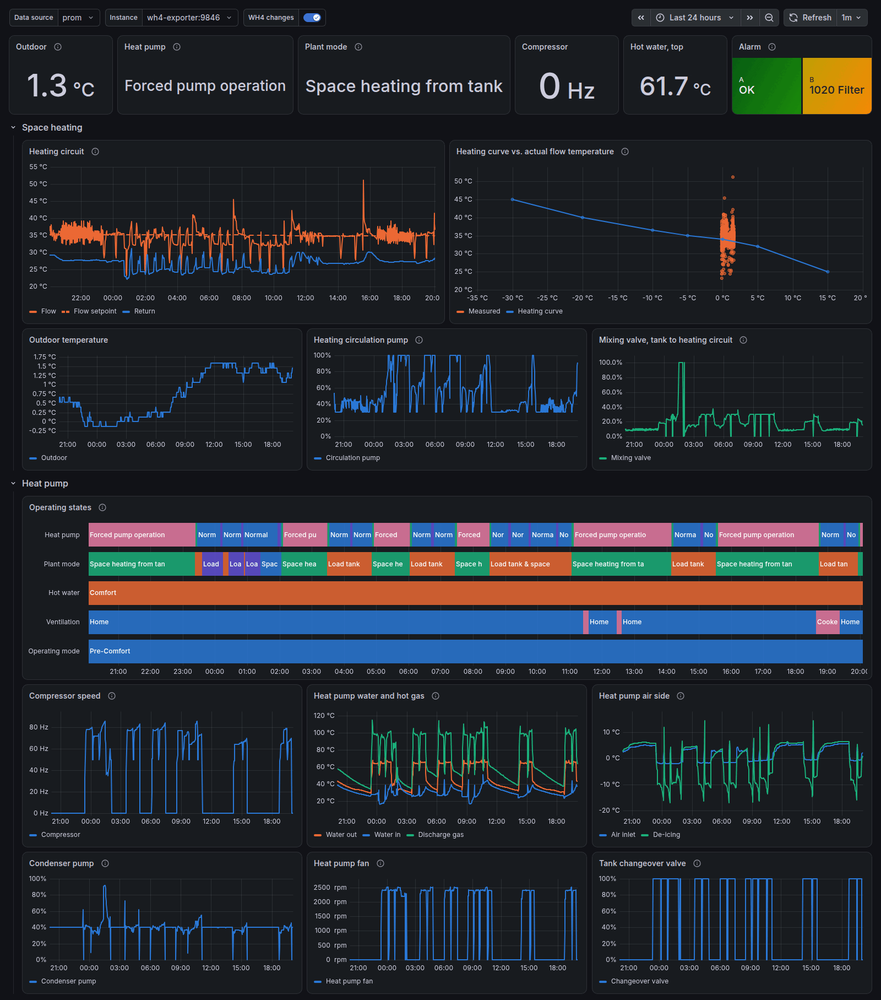

# flexit-wh4-exporter

A [Prometheus](https://prometheus.io/) exporter and Grafana dashboard for the
**Flexit EcoNordic WH4** combined heat pump, hot water tank and ventilation unit.
It reads the unit's built-in BACnet/IP interface over your local network, so you get history for
everything the Flexit GO app only shows as live values: heat pump state and compressor speed, flow
and return temperatures, the heating curve, hot water tank temperatures, ventilation, alarms and
operating hours.

[](docs/dashboard-full.png)

> This project is not affiliated with or endorsed by Flexit. Use it at your own risk.

## Details
* Python 3 (tested with 3.13 and 3.14), using [bacpypes3](https://github.com/JoelBender/BACpypes3)
  and [prometheus_client](https://github.com/prometheus/client_python).
* **Read-only.** The exporter only sends BACnet ReadPropertyMultiple requests. It never writes to
  the unit.
* **No extra hardware.** It uses the network connection the unit already has for Flexit GO. You
  don't need a Modbus adapter or the cloud.
* **Light on the unit.** Each scrape reads all 108 points in a single request, which takes about
  0.1–0.2 s. A scrape interval of 15–60 s is plenty.
* **Grafana dashboard** in [grafana/wh4-dashboard.json](grafana/wh4-dashboard.json), including the
  configured heating curve plotted against the measured flow temperature. See
  [docs/dashboard.md](docs/dashboard.md).

### Compatibility
Tested with a Flexit EcoNordic WH4 (ventilation module art. 800481) with a Siemens Climatix
`POS3.67` controller (BACnet vendor "Siemens Building Technologies"), firmware `FW=03.39.03.30`
and application `HvacFnct25y_A` 2.425.

Other EcoNordic units (WH4 XL, W4) and Flexit Nordic units use the same controller family.
They will probably work, but points they don't have (for example the heat pump on a W4) will fail
to read. Failed points are skipped and counted in `wh4_point_errors`. Remove them from
[points.yaml](points.yaml) to get rid of the warnings. Reports from other units are welcome.

## Installation
### Before you start
1. **Find the unit's IP address.** In Flexit GO it's under *More → System information*. Give the
   unit a fixed address (a DHCP reservation) so it doesn't change.
2. **Check the BACnet settings.** BACnet/IP is enabled by default, with device ID `2` on UDP port
   `47808`. You can see the settings in Flexit GO when logged in locally as installer
   (*More → Installer → Communication → BACnet settings*).
3. **Make sure the exporter host can reach the unit on UDP 47808.** If the unit is on another
   subnet or VLAN, unicast works fine across routers. BACnet discovery broadcasts are not needed.

### Docker
Edit `WH4_TARGET` in [docker-compose.yml](docker-compose.yml), then:
```bash
git clone https://github.com/sandnabba/flexit-wh4-exporter.git
cd flexit-wh4-exporter
docker compose up -d --build
curl -s localhost:9846/metrics | grep wh4_up
```

### Python
```bash
git clone https://github.com/sandnabba/flexit-wh4-exporter.git
cd flexit-wh4-exporter
python3 -m venv .venv
.venv/bin/pip install -r requirements.txt
.venv/bin/python wh4_exporter.py --target 192.168.1.50 --once   # read once, print the metrics and exit
.venv/bin/python wh4_exporter.py --target 192.168.1.50          # serve http://0.0.0.0:9846/metrics
```
There is also a hardened systemd unit in [wh4-exporter.service](wh4-exporter.service), with the
install steps in its comments.

## Configuration
Every option can also be set with an environment variable.

| Option | Environment | Default | |
|---|---|---|---|
| `--target` | `WH4_TARGET` | *(required)* | IP address of the unit, `host[:port]` |
| `--device-id` | `WH4_DEVICE_ID` | `2` | BACnet device instance of the unit |
| `--local-address` | `WH4_LOCAL_ADDRESS` | `0.0.0.0:47809` | Local BACnet address to bind, `ip[/prefix][:port]` |
| `--instance` | `WH4_INSTANCE` | `3999999` | BACnet device instance of the exporter itself |
| `--listen` | `WH4_LISTEN` | `0.0.0.0:9846` | HTTP address for `/metrics` |
| `--points` | `WH4_POINTS` | `points.yaml` | Point list |
| `--cache-seconds` | `WH4_CACHE_SECONDS` | `5` | Reuse a read that is younger than this |
| `--chunk-size` | `WH4_CHUNK_SIZE` | `150` | Objects per ReadPropertyMultiple request |
| `--timeout` | `WH4_TIMEOUT` | `10` | Timeout per request, seconds |
| `--log-level` | `WH4_LOG_LEVEL` | `INFO` | |

The exporter binds UDP port 47809 by default, so it doesn't clash with other BACnet software on
the same host.

## Prometheus
```yaml
scrape_configs:
  - job_name: wh4
    scrape_interval: 60s
    static_configs:
      - targets: ["exporter-host:9846"]
```

All metrics have the prefix `wh4_`. Enum points are exported both as `<name>{state="..."}`
(1 for the active state, with the state texts read from the unit) and as `<name>_code`, and
operating hours as counters in seconds. `wh4_up` is 1 if the last BACnet read succeeded, and
`wh4_point_errors` counts points that couldn't be read.
The full list is in [docs/metrics.md](docs/metrics.md).

## Grafana
Import [grafana/wh4-dashboard.json](grafana/wh4-dashboard.json) (*Dashboards → New → Import*) and
pick your Prometheus data source. Tested with Grafana 13.
Annotations tagged `wh4` are shown on every time series panel, so you can log setting changes and
compare before and after. See [docs/dashboard.md](docs/dashboard.md) for the panels and how to add
annotations.

## Good to know
* **No energy metering.** The unit doesn't measure its own electricity use or heat output. To
  calculate COP or cost you need a separate electricity meter on the unit's supply.
* **No room temperature.** The room temperature object reads 0 on the WH4. Use the extract air
  temperature instead (`wh4_air_temperature_celsius{position="extract"}`).
* **Operating hours are whole hours.** The counters have 1-hour resolution, so rates over short
  time ranges are coarse.
* **Security.** BACnet has no authentication. Anything that can reach the unit on UDP 47808 can
  also *write* to it, including setpoints and modes. Keep the unit on a network segment you trust.

## Documentation
* [docs/metrics.md](docs/metrics.md) - All metrics and their labels
* [docs/dashboard.md](docs/dashboard.md) - The Grafana dashboard and annotations
* [docs/development.md](docs/development.md) - How it works, adding points, the dashboard
  generator and the local dev stack
* [docs/bacnet-objects.csv](docs/bacnet-objects.csv) - All ~2000 BACnet objects of a WH4, with
  the controller's own names, descriptions, units and state texts

## Credits
* [piotrbulinski/flexit_bacnet](https://github.com/piotrbulinski/flexit_bacnet) and the Home
  Assistant community thread on Flexit Nordic BACnet, where much of this was first mapped.
* The Flexit GO user manual for EcoNordic, which lists BACnet objects and Modbus registers per
  parameter.

## Contribution
Please open an issue or a pull request with questions and/or suggestions, especially if you have
tested it on another Flexit unit.

## License
MIT, see [LICENSE.md](LICENSE.md).
