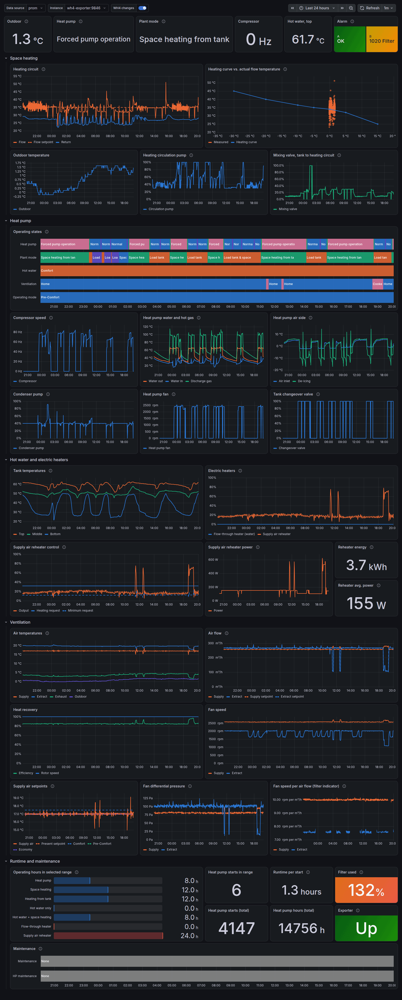

# Grafana dashboard

Import [grafana/wh4-dashboard.json](../grafana/wh4-dashboard.json) (*Dashboards → New → Import*)
and pick your Prometheus data source. The dashboard has `datasource` and `instance` variables, so
it works with any data source name and with several units. Tested with Grafana 13.

[](dashboard-full.png)

## Panels

* **Overview:** outdoor temperature, heat pump state, plant mode, compressor speed, hot water
  temperature and active alarms.
* **Space heating:** flow, setpoint and return, the circulation pump and the mixing valve between
  the tank and the heating circuit. The configured heating curve is plotted against the measured
  flow temperature, so you can see how the curve plays out in practice.
* **Heat pump:** a timeline of operating states (including the operating mode), compressor speed,
  water, hot gas and air side temperatures, the condenser pump, the heat pump fan and the tank
  changeover valve.
* **Hot water and electric heaters:** tank temperatures, the flow-through heater and the supply
  air reheater (control, heating request, power and energy in the selected range).
* **Ventilation:** air temperatures, supply air setpoints per operating mode, air flow, heat
  recovery, fans, fan pressure and fan speed per air flow, which rises as the filters clog.
* **Runtime and maintenance:** operating hours per function, heat pump starts, runtime per start,
  filter usage and a timeline of maintenance functions such as legionella prevention.

## Annotations

Grafana annotations tagged `wh4` are shown on every time series panel (toggle *WH4 changes* at the
top). Use them to log setting changes, so you can compare before and after. Add one from any panel
(Ctrl+click, tag `wh4`) or through the API with a service account token:

```bash
curl -H "Authorization: Bearer $TOKEN" -H "Content-Type: application/json" \
  -d '{"time": 1793522220000, "tags": ["wh4"], "text": "Heating curve +2 K at 0 and +5 °C"}' \
  https://grafana.example.com/api/annotations
```

## Changing the dashboard

The dashboard JSON is generated by [grafana/build_dashboard.py](../grafana/build_dashboard.py).
Make changes there and regenerate, rather than editing the JSON by hand:

```bash
python3 grafana/build_dashboard.py grafana/wh4-dashboard.json
```

See [development.md](development.md#dashboard-generator) for the conventions the generator follows
and a local stack to test it in.
